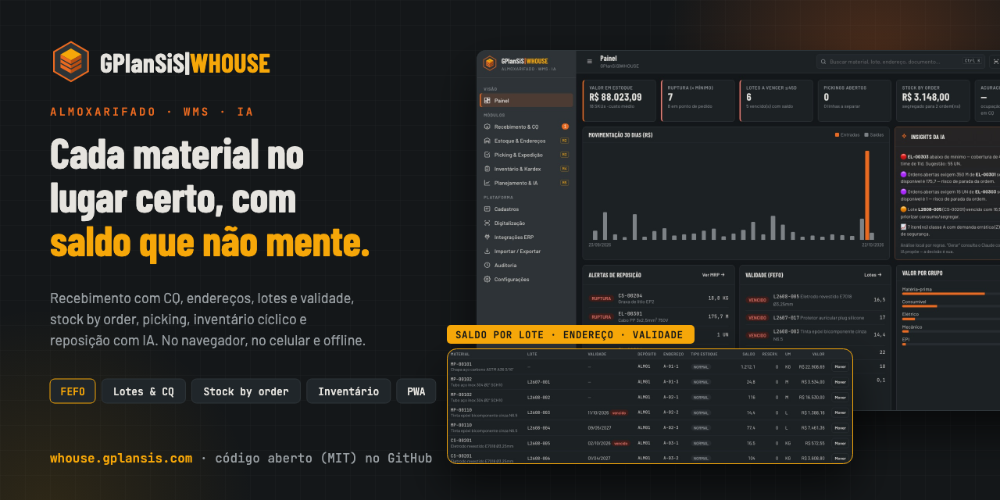
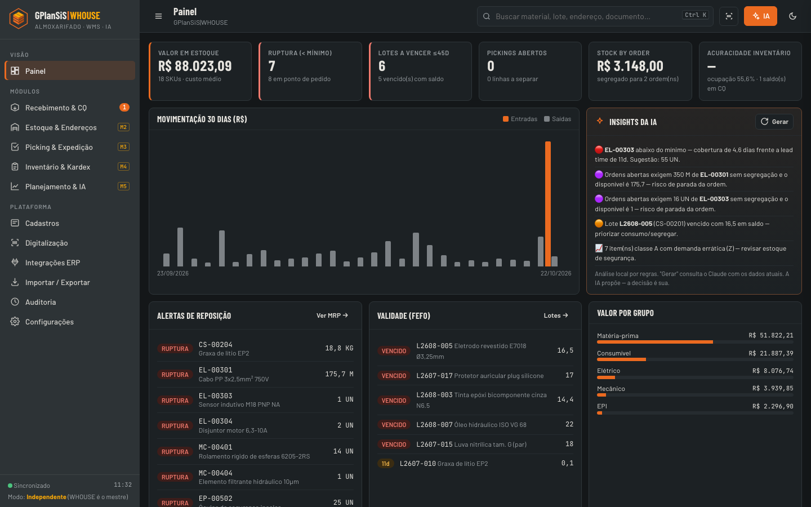
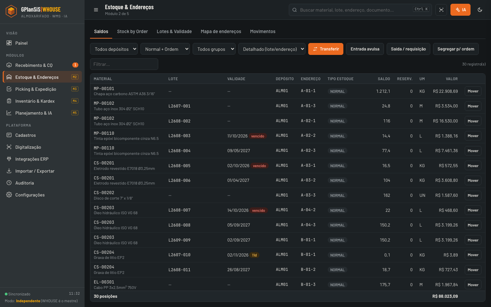
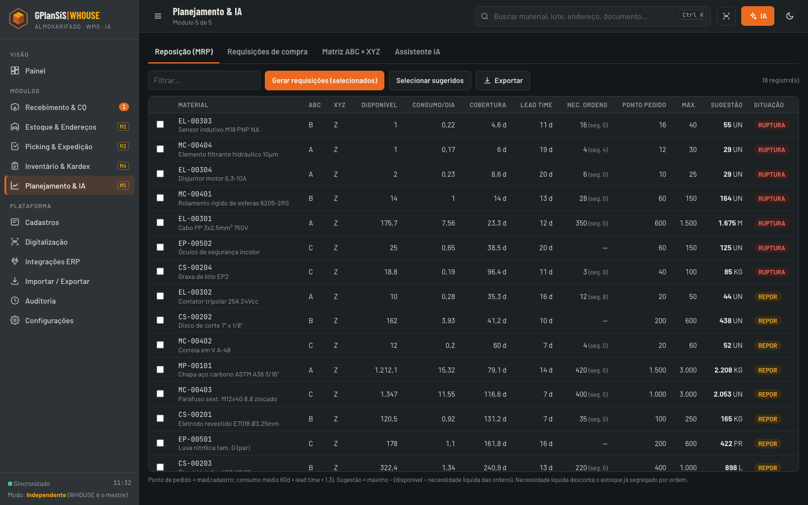
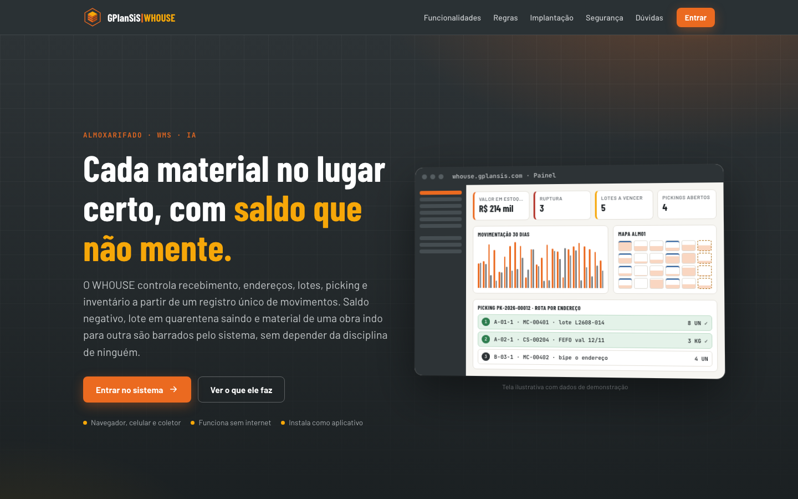
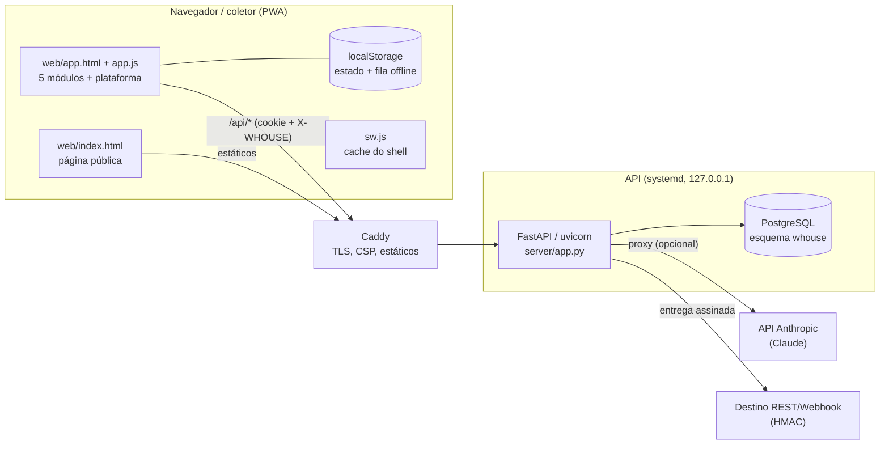

<p align="center">
  <a href="https://whouse.gplansis.com"></a>
</p>

<h1 align="center">GPlanSiS|WHOUSE</h1>

<p align="center">
  <strong>Almoxarifado e WMS multiusuário: recebimento com CQ, endereços, lotes e validade, stock by order, picking, inventário cíclico e reposição com IA.</strong><br>
  No navegador, no celular e no coletor — e funciona sem internet.
</p>

<p align="center">
  <a href="https://whouse.gplansis.com"></a>
  <a href="LICENSE"></a>
  
  
  
  <a href="CONTRIBUTING.md"></a>
</p>

<p align="center">
  <a href="https://whouse.gplansis.com"><b>➜ Abrir o GPlanSiS|WHOUSE em whouse.gplansis.com</b></a>
</p>

---

## O que é

O **GPlanSiS|WHOUSE** controla recebimento, endereços, lotes, picking e inventário a partir de um **registro único de movimentos**: o saldo é a soma dos movimentos, por lote, endereço e tipo de estoque. Saldo negativo, lote em quarentena saindo e material de uma obra indo para outra são barrados pelo sistema, sem depender da disciplina de ninguém.

É um aplicativo web instalável (PWA) que roda de dois jeitos:

- **Multiusuário** (servido pelo servidor, como em whouse.gplansis.com): login, perfis, estado compartilhado e versionado no PostgreSQL, sincronização com merge automático entre usuários e operação offline com envio na reconexão.
- **Local** (abrindo `web/app.html` direto do disco): sem servidor e sem login, com os dados no próprio navegador — útil para conhecer o sistema com a base de demonstração.

## Funcionalidades

### Cinco módulos de operação
- **M1 · Recebimento & CQ** — entrada pelo **XML da NF-e**, conferência cega (o conferente não vê a quantidade da nota), divergência NF × físico, quarentena com liberação ou rejeição pela qualidade, lote gerado automaticamente e etiqueta na hora.
- **M2 · Estoque & Endereços** — depósitos, ruas, prédios e níveis, **mapa de ocupação**, saldo por lote, endereço e tipo de estoque, transferências, lotes e validade, **stock by order** (saldo segregado por OP, OS, projeto ou OV, consumido só pela ordem dona).
- **M3 · Picking & Expedição** — lista de separação gerada da ordem com alocação **FEFO/FIFO** e rota ordenada por endereço, confirmação por leitura de endereço e material, ondas de separação, romaneio e baixa na expedição.
- **M4 · Inventário & Kardex** — contagem cega com saldo congelado, recontagem obrigatória acima da tolerância, aprovação que gera o ajuste, cíclico por curva ABC, acuracidade por classe, Kardex com custo médio.
- **M5 · Planejamento & IA** — reposição (MRP) por consumo, lead time e necessidade das ordens já descontado o segregado, matriz **ABC × XYZ**, requisições de compra com aprovação e **Assistente IA** que consulta os dados e só propõe.

### Invariantes (regras que o sistema não deixa quebrar)
- **Sem saldo negativo** — a saída é checada por posição, lote e tipo de estoque.
- **Quarentena não sai** — lote em inspeção ou bloqueado fica fora da alocação e das requisições.
- **Estoque da ordem é da ordem** — saldo segregado só é consumido pela ordem dona até ser liberado.
- **Histórico não se apaga** — movimentos só são acrescentados; correção é por estorno ou ajuste, com autor e data.
- **A IA propõe, você decide** — o assistente cria apenas propostas; a aprovação é sempre de uma pessoa.

### Plataforma
- **Coletor móvel**: leitura de código de barras pela câmera (`BarcodeDetector`) ou leitor Bluetooth; etiquetas **Code128** de endereço, material e lote impressas pelo navegador.
- **Importar / Exportar** XLSX, CSV e JSON (SheetJS local, sem CDN), com validação linha a linha.
- **Integrações ERP** com fila de saída (outbox): SAP Business One, TOTVS Protheus, Senior, Sankhya, Odoo, arquivo (CSV/XLSX) e **REST/Webhook genérico** — este entrega de verdade pelo servidor, com `Idempotency-Key` e assinatura HMAC-SHA256. Os conectores de ERP dependem de um gateway com as credenciais do cliente; a fila retém essas mensagens até lá.
- **Usuários & Acessos**: perfis ADMIN, GESTOR, OPERADOR e CONSULTA, módulos personalizáveis por pessoa, registro de acessos, histórico das últimas 300 versões do estado com restauração.
- **Auditoria** de todas as operações e tema claro/escuro.

### Segurança do modo multiusuário
Senhas com **scrypt** (mínimo de 10 caracteres com maiúscula, minúscula e número), senha temporária com troca obrigatória, bloqueio de 15 min após 5 falhas, sessão em cookie HttpOnly + Secure + SameSite=Strict (12 h deslizantes), cabeçalho anti-CSRF `X-WHOUSE` em toda mutação, CSP sem script externo. O perfil CONSULTA é recusado pelo servidor em qualquer gravação, e o servidor confere cada gravação do estado contra o papel e os módulos de quem grava: configurações e conectores só para GESTOR com o módulo, aprovação de inventário, de requisição e liberação de CQ só para GESTOR, movimentos lançados nunca são apagados nem alterados (reinício e restauração são do ADMIN). A chave da IA fica só no servidor (`server/ia_cota.py`), que monta o prompt e as ferramentas, aplica cota mensal em US$ por pessoa (padrão US$ 20, ajustável pelo ADMIN em `/api/admin/ia` e por pessoa) e limita 30 chamadas por minuto e 3 simultâneas. O webhook só entrega para IP público (conexão no IP já validado, sem DNS rebinding). Login com a mesma resposta para conta inexistente, senha errada ou bloqueada.

## Telas

| Painel | Estoque & Endereços |
|---|---|
|  |  |
| **Planejamento & IA (MRP)** | **Página inicial** |
|  |  |

> Capturas feitas numa instância local com a **base de demonstração** gerada pelo próprio sistema (materiais, fornecedores e ordens fictícios).

## Arquitetura



- **Estado como documento versionado** (`whouse.estado`): cada gravação envia a versão-base; se outro usuário gravou antes, o servidor responde `409` e o cliente faz **merge 3-vias por entidade** (ledger por id, cadastros por chave, contadores pelo máximo), renumera documentos que colidiram e reenvia. As últimas 300 versões ficam em `whouse.estado_hist`.
- **Offline**: as alterações ficam no aparelho e sobem na reconexão; o service worker só guarda o shell estático.
- Em produção o **Caddy** serve `web/` e encaminha `/api/*` para o uvicorn em `127.0.0.1:8980` (unit systemd endurecida: `NoNewPrivileges`, `ProtectSystem=strict`…). Em desenvolvimento o próprio uvicorn serve `web/` (`WHOUSE_WEB`).

## Stack

| Camada | Tecnologia |
|---|---|
| Frontend | HTML, CSS e JavaScript sem build, PWA, SheetJS (`xlsx`) local, fontes Barlow / JetBrains Mono (Google Fonts) |
| Backend | Python 3.12+, FastAPI, uvicorn, psycopg 3 (pool), httpx |
| Banco | PostgreSQL 16+ (esquema `whouse`, criado na subida) |
| IA | API da Anthropic (Claude) via proxy no servidor — opcional |
| Implantação | systemd + Caddy (`deploy/`) |

## Como rodar localmente

### Só o navegador (sem servidor)
Abra `web/app.html` direto no navegador. Sem servidor, o WHOUSE entra no **modo local**: sem login, dados no `localStorage` e base de demonstração gerada na primeira abertura (em **Configurações** dá para recriar a base demo ou começar vazia).

### Multiusuário (servidor + PostgreSQL)
Requisitos: Python 3.12+ (testado com 3.14) e PostgreSQL 16+.

```bash
git clone https://github.com/SSBianchiplan/whouse.git
cd whouse
createdb whouse                                   # ou use um banco existente
python3 -m venv .venv
.venv/bin/pip install -r server/requirements.txt

export WHOUSE_DSN="postgresql:///whouse"          # ajuste usuário/host/porta
export WHOUSE_MASTER=admin@exemplo.com
export WHOUSE_COOKIE_SEGURO=0                     # só para http://localhost
export WHOUSE_WEB="$PWD/web"                      # o uvicorn serve o frontend

# cria o administrador e imprime uma senha temporária (troca obrigatória no 1º acesso)
(cd server && ../.venv/bin/python app.py criar-admin --login admin@exemplo.com --nome "Admin Exemplo")

.venv/bin/uvicorn app:app --app-dir server --port 8980
```

Abra <http://localhost:8980/app.html>, entre com o login e a senha temporária e defina a nova senha. O estado começa vazio: em **Configurações › Recriar base demo** você gera dados fictícios para explorar.

- O esquema `whouse` é criado (de forma idempotente) a cada subida, a partir de `server/schema.sql`.
- A IA fica no motor local de regras até você definir `ANTHROPIC_API_KEY`.
- Testes de segurança (precisam de um PostgreSQL descartável; o esquema `whouse` é apagado e recriado): `WHOUSE_TEST_DSN=postgresql://usuario@localhost/whouse_teste WHOUSE_DSN_TESTE=postgresql://usuario@localhost/whouse_teste .venv/bin/python -m pytest server/tests -q` (instale `pytest`).

### Produção
`deploy/publicar.sh` valida o código, monta o pacote e chama `deploy/instalar.remoto.sh` no servidor (usuário de sistema, banco por autenticação peer, venv, unit systemd `whouse.service`, bloco `whouse.caddy` validado antes do reload e backup do pacote anterior). Os segredos ficam em `/opt/whouse/.env`, preenchidos à mão. Detalhes de operação em [`LEIA-ME.md`](LEIA-ME.md).

## Estrutura de pastas

```
whouse/
├── web/                      # frontend estático (PWA)
│   ├── index.html, landing.js    # página pública
│   ├── app.html, app.js          # aplicação: 5 módulos + plataforma
│   ├── sw.js, manifest.webmanifest
│   ├── icons/                    # ícones e logotipo
│   └── vendor/xlsx.full.min.js   # SheetJS (Apache-2.0)
├── server/
│   ├── app.py                # API FastAPI + CLI criar-admin
│   ├── schema.sql            # esquema PostgreSQL (idempotente)
│   └── requirements.txt
├── deploy/
│   ├── publicar.sh, instalar.remoto.sh
│   ├── whouse.service        # unit systemd
│   ├── whouse.caddy, csp.txt # bloco do Caddy e CSP
│   └── .env.example
└── LEIA-ME.md                # notas de operação
```

## Variáveis de ambiente

| Variável | Uso | Padrão |
|---|---|---|
| `WHOUSE_DSN` | Conexão com o PostgreSQL | `postgresql:///whouse` |
| `WHOUSE_MASTER` | Login do administrador master (não pode ser rebaixado nem desativado) | vazio |
| `WHOUSE_SESSAO_HORAS` | Duração da sessão (renovada a cada uso) | `12` |
| `WHOUSE_COOKIE_SEGURO` | `0` desliga o cookie Secure (só para desenvolvimento em HTTP) | `1` |
| `WHOUSE_WEB` | Pasta do frontend servida pelo uvicorn (desenvolvimento) | vazia (Caddy serve) |
| `ANTHROPIC_API_KEY` | Liga o Assistente IA pelo servidor | vazia (motor local de regras) |
| `WHOUSE_IA_MODELO` | Modelo do Claude | `claude-sonnet-5` |
| `WHOUSE_WEBHOOK_SEGREDO` | Segredo HMAC do conector REST/Webhook | vazio |

Modelo em [`deploy/.env.example`](deploy/.env.example). Nunca versione o `.env` real.

## Contribua

O WHOUSE quer ser o almoxarifado que pequenas e médias indústrias conseguem implantar numa tarde — sem build, sem servidor caro, com regras que não deixam o saldo mentir. **Toda ajuda conta**, de uma correção de texto a um conector novo.

**Por onde começar (boas primeiras issues):**
- 🧪 **Mais testes** da API: já há `server/tests/` (segurança: login, permissões do estado, webhook, SheetJS; cota de IA; e um teste no navegador com Playwright). Faltam conflito `409`/merge e restauração de versão.
- 🗃️ **Ledger no banco**: levar os movimentos para uma tabela append-only com saldo calculado no PostgreSQL (hoje o estado é um documento único — limite conhecido para volumes grandes).
- 🔌 **Conectores ERP**: gateways reais para SAP B1 (Service Layer), TOTVS, Sankhya, Odoo, consumindo a fila de saída.
- 🧾 **NF-e**: cobrir mais variações do XML (devolução, remessa, CT-e).
- 🌐 **Internacionalização** e ♿ **acessibilidade** (navegação por teclado, contraste, leitores de tela no coletor).
- 🛠️ **CI**: GitHub Actions com `node --check`, ruff e testes.

Leia o [guia de contribuição](CONTRIBUTING.md), abra uma [issue](../../issues/new/choose) para combinar a ideia e mande seu pull request. Siga o [código de conduta](CODE_OF_CONDUCT.md). Encontrou uma falha de segurança? Veja a [política de segurança](SECURITY.md) — não abra issue pública.

## Licença

Código próprio sob a **[licença MIT](LICENSE)** — Copyright (c) 2026 GPlanSiS.

Componentes de terceiros: **SheetJS Community Edition 0.20.3** (`web/vendor/xlsx.full.min.js`, baixado de cdn.sheetjs.com; SHA-256 `cc015130aa8521e7f088f88898eba949ccdcbfb38df0bd129b44b7273c3a6f41`) sob a licença Apache-2.0; fontes **Barlow**, **Barlow Condensed** e **JetBrains Mono** (SIL Open Font License 1.1), carregadas do Google Fonts. Dependências Python: FastAPI (MIT), uvicorn (BSD-3-Clause), psycopg (LGPL-3.0, instalado pelo pip, não incluído), httpx (BSD-3-Clause).

## Créditos

Desenvolvido pela **[GPlanSiS|Group](https://gplansis.com)** · contato: [contato@gplansis.com](mailto:contato@gplansis.com)

<p align="center"><a href="https://whouse.gplansis.com"><b>whouse.gplansis.com</b></a></p>
